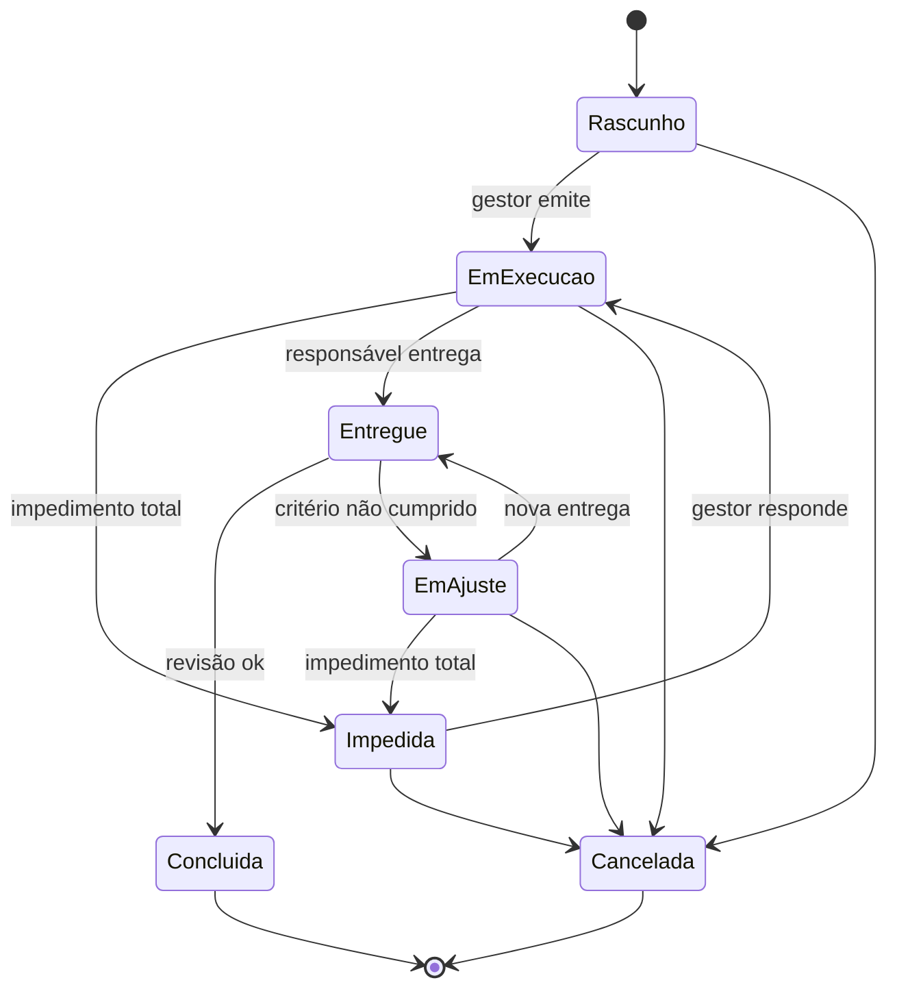

# Especificação — App de missões (PWA)

Versão 1.0 • 18/10/2026 • Base: `protocolo_missoes.md` v2.7

> **Para quem vai construir.** Este documento diz **o que** o app faz e **como** ele é construído. As regras de uso, o porquê de cada campo e o exemplo completo estão no protocolo. Em caso de conflito, o protocolo vence. Não acrescente mecanismos que não estejam aqui ou no protocolo, e nunca aumente o registro diário do responsável.

---

## 1. Contexto e escopo

| Item | Definição |
|---|---|
| Usuários | 4 pessoas: 1 gestor e 3 responsáveis |
| Substitui | Kanban e GitHub Projects |
| Unidade | Missão = tarefa com ID, um responsável e uma data estimada única. Não é projeto |
| Escopo da v1 | Folha da missão (responsável e gestor), lista e painel do gestor, criação de missão, revisão |
| Fora da v1 | Ver seção 13 (inclui o chat numa segunda aba) |

## 2. Decisões vigentes

| Tema | Decisão | Motivo |
|---|---|---|
| Quem define o quê | O gestor preenche o cabeçalho: descrição, requisitos, data estimada e links | O gestor tem a visão global |
| Como se faz | O responsável escreve as etapas e decide o método | Respeito às pessoas: o como é de quem executa |
| Acordo | Não há passo de aprovação. Há um aviso único ao gestor quando o primeiro plano é salvo | *Backbrief* reduzido a uma leitura |
| Requisitos | Precisa acontecer (*Must*), não pode acontecer (*Must not*) e consultar antes | Limites globais à missão (MoSCoW) |
| Critérios de conclusão | Uma linha: "condição — verificado por [inspeção / análise / demonstração / teste]" | Verificação de requisitos |
| Etapa × atividade | Etapas: escritas uma vez, no início. Atividade: a principal de cada dia | Alinhar o entendimento sem dobrar o cadastro |
| Registro diário | Uma linha: data, atividade com auto-complete e um ícone | Custo mínimo de registro |
| Data | Data estimada, não prazo | Estimativa, sem cobrança |
| Sinais | Só na tela do gestor; metade deles cobra o próprio gestor | Gestão sem atrito |
| Acesso | Cada missão é individual; só o gestor vê a lista | Missões são individuais |
| Comunicação | Pendência e resposta; resposta ≠ alteração; quem abre, fecha | Registro na folha; controle de mudanças |

## 3. Arquitetura

**Decisão: PWA estático, sem servidor próprio, com os dados no Google Drive.**

| Peça | Escolha | Motivo |
|---|---|---|
| App | PWA estático (HTML, CSS e JavaScript em módulos; sem *build* obrigatório), hospedado em qualquer serviço de páginas estáticas | Nada para manter rodando |
| Login | Conta Google (Google Identity Services, OAuth) | A equipe já usa Google Docs e Drive |
| Dados | Arquivos JSON no Google Drive, na pasta de cada missão | O compartilhamento do Drive já faz o controle de acesso |
| Escopo de acesso ao Drive | `drive`, com o app no Google Cloud em modo de teste, liberado só para os 4 usuários | Com o escopo menor (`drive.file`), o responsável teria de abrir cada pasta compartilhada pelo seletor do Google uma vez, o que é atrito. O app só lê e grava dentro de `Missões/` |
| Offline | Cache em IndexedDB e fila de gravação; sincroniza ao voltar a conexão | O registro do dia não pode depender de sinal |
| Análise | `analise.js`, módulo de funções puras, roda no aparelho do gestor | Sem banco de dados nem servidor |

**Organização no Drive** (criada pelo app, no Drive do gestor):

```
Missões/                      pasta raiz, só do gestor
  config.json                 feriados e lista da equipe (gestor grava)
  MS-027 — Calibrar sensor…/  pasta da missão = link "Pasta" do cabeçalho
    gestor.json               só o gestor grava
    responsavel.json          só o responsável grava
    (insumos, trabalho e evidências)
```

- Ao **emitir** a missão, o app cria a pasta e os dois arquivos e compartilha a pasta com o responsável, como editor.
- **Um escritor por arquivo:** o gestor nunca grava `responsavel.json`, e o responsável nunca grava `gestor.json`. Assim não há conflito de gravação simultânea.
- A **situação** da missão não é gravada: é calculada a partir dos dois arquivos (`situacao()` em `analise.js`).
- O responsável abre o app e vê só as missões cujas pastas foram compartilhadas com ele (busca no Drive por `gestor.json` compartilhado com o usuário). A pasta raiz e as missões dos outros não aparecem.
- **Limite assumido:** como editor da pasta, o responsável conseguiria mudar `gestor.json` direto no Drive, fora do app. A equipe é de confiança, o app nunca faz isso, e o Drive guarda o histórico de versões de cada arquivo.

## 4. Papéis e acesso

| Bloco | Gestor | Responsável |
|---|---|---|
| 1. Cabeçalho: identificação, links, data estimada, descrição, requisitos | Grava; depois de emitir, só por alteração | Lê |
| 2. Etapas | Lê | Grava e marca como concluída |
| 3. Pendências | Responde (resposta ou alteração) | Abre e fecha |
| 4. Entrega, revisão e encerramento | Revisa e escreve 1 frase | Entrega e escreve 1 frase |
| 5. Registro do dia | Lê, na linha do tempo | Grava; não vê histórico |
| Lista, painel, sinais e linha do tempo | Vê | **Não vê** |

## 5. Modelo de dados

### `gestor.json` (só o gestor grava)

```json
{
  "id": "MS-027",
  "versao": 2,
  "titulo": "Calibrar sensor de umidade em solo argiloso",
  "gestor": { "nome": "…", "email": "…" },
  "responsavel": { "nome": "…", "email": "…" },
  "docsUrl": "https://docs.google.com/…",
  "pastaId": "id da pasta no Drive",
  "emitidaEm": "2026-10-19",
  "dataEstimada": "2026-10-28",
  "descricao": {
    "necessidade": "…",
    "resultadoEsperado": "…",
    "tarefa": "…",
    "entrega": "…",
    "criterios": [{ "condicao": "Erro médio ≤ 3 p.p., 4 níveis × 3 rep.", "verificacao": "teste" }],
    "insumos": "…"
  },
  "requisitos": {
    "precisa": ["Registrar todas as leituras, inclusive as descartadas, com o motivo"],
    "naoPode": ["Usar solo de outra classe textural"],
    "consultarAntes": ["Mudar o número de níveis ou de repetições"]
  },
  "alteracoes": [{ "versao": 2, "em": "2026-10-22T15:00", "resumo": "Critério passa a 4 × 3", "pendenciaId": "p1" }],
  "respostas": [{ "pendenciaId": "p1", "em": "2026-10-22T15:00", "tipo": "alteracao", "texto": "De acordo: 4 níveis × 3 rep." }],
  "revisoes": [{ "entregaId": "e1", "em": "2026-10-28", "resultado": "concluida", "produto": "atende", "ajustes": [] }],
  "fraseGestor": "Nas próximas calibrações, a capacidade da estufa entra nos insumos.",
  "cancelada": null
}
```

### `responsavel.json` (só o responsável grava)

```json
{
  "vistoVersao": 2,
  "primeiroPlanoEm": "2026-10-19T09:30",
  "etapas": [
    { "id": "t1", "ordem": 1, "nome": "Amostras preparadas", "concluidaEm": "2026-10-19" },
    { "id": "t2", "ordem": 2, "nome": "Níveis 1 a 3 medidos", "concluidaEm": null }
  ],
  "registros": [
    { "dia": "2026-10-20", "atividade": "secar amostras n1", "motivo": null },
    { "dia": "2026-10-23", "atividade": null, "motivo": "outra_missao" }
  ],
  "pendencias": [
    { "id": "p1", "tipo": "impedimento", "bloqueio": "parte", "texto": "…", "abertaEm": "2026-10-22T10:00", "fechadaEm": "2026-10-22T16:00" }
  ],
  "entregas": [
    { "id": "e1", "em": "2026-10-27T17:00", "resultado": "…",
      "evidencias": [{ "criterio": 0, "status": "atendido", "onde": "pasta/planilha.xlsx" }],
      "desvios": "…" }
  ],
  "fraseResponsavel": "A folha deveria ter dito a capacidade da estufa."
}
```

**Valores fechados:**

| Campo | Valores |
|---|---|
| `verificacao` | `inspecao`, `analise`, `demonstracao`, `teste` |
| `pendencias[].tipo` | `duvida`, `consulta`, `impedimento`, `nova_data` |
| `pendencias[].bloqueio` | `tudo`, `parte`, `nenhum` |
| `registros[].motivo` | `folga_saude`, `outra_missao`, `fora_de_missao` |
| `respostas[].tipo` | `resposta`, `alteracao` |
| `revisoes[].resultado` | `concluida`, `em_ajuste` |
| `revisoes[].produto` | `atende`, `nao_atende`, `inconclusivo` |
| `evidencias[].status` | `atendido`, `parcial`, `nao_atendido` |

**Regras de validação:**
- Um registro por `dia`. Gravar de novo no mesmo dia substitui o anterior.
- Cada registro tem `atividade` **ou** `motivo`, nunca os dois. A atividade é gravada sem espaços nas pontas.
- Nova data: o gestor responde com `alteracao`, e o app grava a nova `dataEstimada` e avança a `versao`.

## 6. Situações e transições

A situação é **calculada**, na ordem de prioridade abaixo (`situacao()` em `analise.js`):

| Ordem | Situação | Condição |
|---|---|---|
| 1 | Cancelada | `cancelada` preenchido |
| 2 | Rascunho | sem `emitidaEm` |
| 3 | Concluída | a última entrega tem revisão `concluida` |
| 4 | Entregue | a última entrega ainda não tem revisão |
| 5 | Impedida | há impedimento `tudo` aberto e sem resposta |
| 6 | Em ajuste | a última entrega tem revisão `em_ajuste` |
| 7 | Em execução | nenhuma das anteriores |



## 7. Regras de cálculo (`analise.js`)

| Função | O que calcula |
|---|---|
| `diasUteis(de, ate, feriados)` | Dias úteis no intervalo (de, ate], sem fins de semana e feriados |
| `dataExibida(g, r, hoje)` | Data estimada mais os dias úteis de impedimento total, da abertura até a resposta |
| `sugerirAtividades(r, prefixo)` | Auto-complete: atividades já usadas, as mais recentes primeiro, sem repetir grafias |
| `sequencias(r)` | Dias de trabalho seguidos com a mesma atividade principal; dias com motivo não quebram a sequência |
| `sinais(g, r, hoje)` | Sinais da seção 8 |
| `linhaPainel(g, r, hoje)` | Uma linha do painel do gestor |
| `linhaDoTempo(r)` | Os registros dia a dia, para o gestor abrir antes de conversar |

**Testes:** o módulo foi testado com o exemplo MS-027 e com missões fictícias (impedimento total, pendência parada, entrega sem revisão e feriado). O resultado de cada caso está na seção 12.

## 8. Sinais (só para o gestor)

| Sinal | Quando aparece | Notifica o gestor? | Apaga quando |
|---|---|---|---|
| Dias sem registro | 2 dias úteis sem registro, fora de impedimento total | Não: marca na lista | O registro é feito |
| Data estimada passou | A data passou sem entrega nem pedido de nova data aberto | Não: marca na lista | Entrega ou nova data |
| Pendência sem resposta | Impedimento: 1 dia útil. Demais tipos: 2 dias úteis | Sim | Resposta |
| Espera pela revisão | Entregue há mais de 2 dias úteis | Sim | Revisão |
| Impedimento respondido e aberto | 3 dias úteis | Sim | O responsável fecha |

A **atividade em dias seguidos** é uma coluna do painel, não um sinal.

## 9. Telas

### 9.1 Folha da missão — responsável

Esboço: `tela_missao_funcionario.svg`. O app abre direto na missão atribuída.

| Ordem | Bloco | Conteúdo |
|---|---|---|
| 1 | Cabeçalho | ID e versão; título com **Docs ↗** e **Pasta ↗** ao lado; situação; data estimada; descrição resumida (com "ver mais"); requisitos. Marca "mudou na vN" no que a última alteração mudou |
| 2 | Etapas | Lista com caixa de conclusão; "editar". No primeiro acesso, o app pede as etapas antes de qualquer outra coisa |
| 3 | Pendências | Lista; "+ abrir" com os 4 tipos; resposta do gestor logo abaixo da pendência; "Fechar pendência" |
| 4 | Entrega | "Preencher": resultado, evidência por critério, desvios e limites |
| 5 | Registro do dia | **Uma linha:** data à esquerda · campo de atividade no meio · ícone de registrar à direita |

**Registro do dia, em detalhe:**

```
┌───────────┬──────────────────────────────────┬─────┐
│ Qui 22/10 │ secar amostras n1                │  ✓  │
└───────────┴──────────────────────────────────┴─────┘
              ┌──────────────────────────────────┐
              │ secar amostras n1                │  ← sugestões (auto-complete)
              │ preparar amostras n2             │
              │ ──────────────────────────────── │
              │ Sem trabalho: folga ou saúde     │
              │ Sem trabalho: outra missão       │
              │ Sem trabalho: fora de missão     │
              └──────────────────────────────────┘
```

- **Data:** hoje, por padrão; um toque abre o seletor, para registrar um dia esquecido.
- **Campo:** texto livre com auto-complete. Escolher uma opção "sem trabalho" grava o `motivo`.
- **Ícone:** grava. Depois de registrar, a linha mostra o registro do dia com o ícone preenchido; tocar de novo permite corrigir.
- Não aparece histórico, contagem nem alerta.

### 9.2 Telas do gestor

| Tela | Conteúdo |
|---|---|
| Lista de missões | Uma linha por missão aberta: ID, título, responsável, situação, data estimada, etapas concluídas, atividade atual e há quantos dias, marcas de sinal. No topo, os sinais que notificam |
| Folha espelhada | A mesma folha, só leitura, com painel da missão e linha do tempo dos registros; botões **Responder**, **Alterar** e **Revisar** |
| Nova missão | Cabeçalho completo; **Emitir** cria a pasta e os arquivos. Mostra os encerramentos de missões parecidas para reler |
| Responder pendência | Escolha entre **Resposta** (texto) e **Alteração** (edita o cabeçalho ou a data, e a versão avança) |
| Revisão | Por critério e requisito: atendido ou não; produto: atende / não atende / inconclusivo; resultado: concluída / em ajuste; frase do gestor |

## 10. Notificações (v1)

Sem servidor próprio, a v1 não envia *push*. As notificações aparecem **ao abrir o app** e no contador do ícone (Badging API, onde houver suporte).

| Evento | Quem é avisado |
|---|---|
| Missão emitida | Responsável |
| Resposta recebida ou alteração feita | Responsável |
| Primeiro plano salvo | Gestor (aviso único) |
| Pendência aberta | Gestor |
| Sinal que notifica (seção 8) | Gestor |
| Entrega feita | Gestor |

*Push* de verdade exige um pequeno serviço de envio (Web Push) e fica para depois (seção 13).

## 11. Fluxo de uso

O diagrama está no protocolo, na seção *Fluxo de uso do app*.

## 12. Critérios de aceite

| # | Critério | Verificação |
|---|---|---|
| 1 | O responsável não consegue abrir a missão de outra pessoa nem a lista | Teste com duas contas |
| 2 | O registro do dia é feito com no máximo 3 toques quando a atividade já existe | Demonstração |
| 3 | O registro feito sem conexão é gravado no Drive quando a conexão volta | Teste |
| 4 | A tela do responsável não mostra sinal, contagem nem histórico | Inspeção |
| 5 | Uma alteração avança a versão e aparece como "não vista" até o responsável abrir a folha | Teste |
| 6 | A pendência só fecha pelo responsável que a abriu | Teste |
| 7 | MS-027 em 23/10: atividade atual *secar amostras n1*, 3 dias seguidos, etapas 1/4, sem sinais | Teste de `analise.js` |
| 8 | MS-027 em 29/10 (impedimento ainda aberto): dias sem registro (4 dias úteis), data estimada passou, impedimento respondido e aberto há 5 dias úteis | Teste de `analise.js` |
| 9 | Impedimento total sem resposta por 5 dias úteis: situação "Impedida", data estimada avança 5 dias úteis, sem sinal de dias sem registro | Teste de `analise.js` |
| 10 | Entrega sem revisão há 5 dias úteis: sinal de espera pela revisão, que notifica | Teste de `analise.js` |
| 11 | Feriado em `config.json` não conta como dia útil | Teste de `analise.js` |

## 13. Fora da v1 (backlog)

| Item | Por que fica para depois |
|---|---|
| **Chat entre responsável e gestor, numa segunda aba da missão** | Na v1, a pendência com resposta cobre a comunicação e deixa registro na folha. Regra para quando entrar: o que for decidido no chat e mudar o cabeçalho vira alteração |
| *Push* (Web Push) | Exige um serviço de envio |
| Seletor de missões para quem tem mais de uma atribuída | Decidir junto com a visão de equipe |
| Visão de equipe: limite de missões em andamento, prioridade, *heijunka*, carga invisível | São regras entre folhas |
| Complemento de pesquisa e teste | Tipo especial de missão |
| Biblioteca de aprendizados dos encerramentos | Por enquanto, o gestor relê os encerramentos das missões parecidas |
| Demais itens | Ver "Fora da versão básica" no protocolo |

## 14. Questões em aberto

- Hospedagem do PWA: GitHub Pages, Firebase Hosting ou outro serviço de páginas estáticas.
- Projeto no Google Cloud para o OAuth: quem cria e quem administra. Se a equipe usar Google Workspace, o app pode ser marcado como interno, sem modo de teste.
- O link "Docs" do cabeçalho: o app cria o documento ao emitir a missão, ou o gestor cola o link?
- Lista de feriados: nacionais apenas, ou também os locais?
