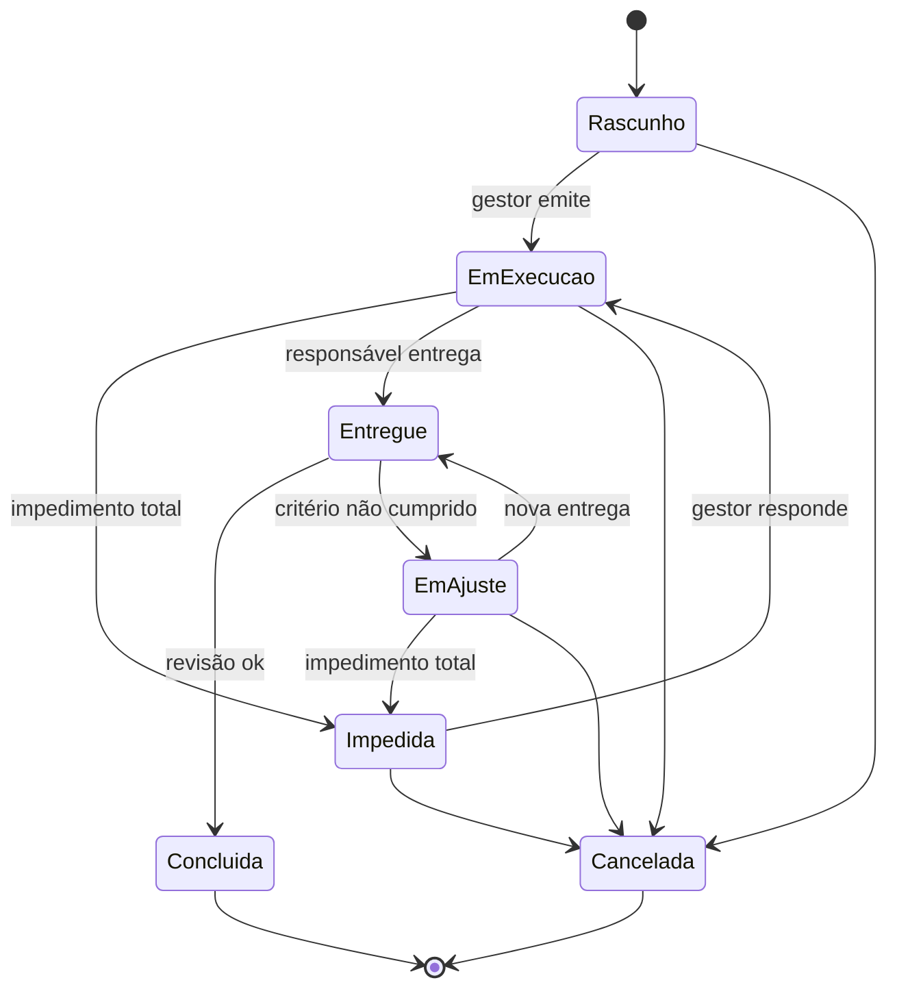

# Especificação — App de missões (PWA)

Versão 1.1 • 18/10/2026 • Base: `protocolo_missoes.md` v2.7

> **Para quem vai construir.** Este documento diz **o que** o app faz e **como** ele é construído. As regras de uso, o porquê de cada campo e o exemplo completo estão no protocolo. Em caso de conflito, o protocolo vence. Não acrescente mecanismos que não estejam aqui ou no protocolo, e nunca aumente o registro diário do responsável.

---

## 1. Contexto e escopo

| Item | Definição |
|---|---|
| Usuários | 4 pessoas: 1 gestor e 3 responsáveis |
| Substitui | Kanban e GitHub Projects |
| Unidade | Missão = tarefa com ID, um responsável e uma data estimada única. Não é projeto |
| Escopo da v1 | Folha da missão (responsável e gestor), lista e painel do gestor, tela Equipe, criação de missão, revisão, notificações |
| Futuro | Pode virar produto para outras equipes; a estrutura de dados já separa as equipes |
| Fora da v1 | Ver seção 13 (inclui o chat numa segunda aba) |

## 2. Decisões vigentes

| Tema | Decisão | Motivo |
|---|---|---|
| Quem define o quê | O gestor preenche o cabeçalho: descrição, requisitos, data estimada e links | O gestor tem a visão global |
| Como se faz | O responsável escreve as etapas e decide o método | Respeito às pessoas: o como é de quem executa |
| Acordo | Não há passo de aprovação. Há um aviso único ao gestor quando o primeiro plano é salvo | *Backbrief* reduzido a uma leitura |
| Requisitos | Precisa acontecer (*Must*), não pode acontecer (*Must not*) e consultar antes | Limites globais à missão (MoSCoW) |
| Critérios de conclusão | Uma linha: "condição — verificado por [inspeção / análise / demonstração / teste]" | Verificação de requisitos |
| Etapa × atividade | Etapas: escritas uma vez, no início. Atividade: a principal de cada dia | Alinhar o entendimento sem dobrar o cadastro |
| Registro diário | Uma linha: data, atividade com auto-complete e um ícone | Custo mínimo de registro |
| Data | Data estimada, não prazo | Estimativa, sem cobrança |
| Sinais | Só na tela do gestor; metade deles cobra o próprio gestor | Gestão sem atrito |
| Acesso | Cada missão é individual; só o gestor vê a lista | Missões são individuais |
| Comunicação | Pendência e resposta; resposta ≠ alteração; quem abre, fecha | Registro na folha; controle de mudanças |
| Plataforma | Firebase: Hosting, Authentication, Firestore, Cloud Messaging e Cloud Functions | Conta do demandante; tempo real, regras de acesso no servidor e notificações; pronto para várias equipes |

## 3. Arquitetura

**Plataforma: Firebase.** Tudo no mesmo projeto, sem servidor próprio para manter.

| Peça | Serviço | Uso |
|---|---|---|
| App | PWA (HTML, CSS e JavaScript em módulos) no **Firebase Hosting** | Um só link para todos |
| Login | **Firebase Authentication**, provedor Google | E-mail e senha ou link por e-mail ficam para quando o app atender outras equipes |
| Dados | **Cloud Firestore** | Leitura em tempo real: a tela espelhada do gestor se atualiza sozinha |
| Proteção | **Regras de segurança do Firestore** | Quem lê e quem grava cada documento é decidido no servidor, não no app |
| Sem conexão | Cache local do Firestore (`persistentLocalCache`) | O registro do dia funciona sem sinal e sincroniza depois |
| Análise | `analise.js`, funções puras | Roda no app do gestor e também na função agendada de notificação. É o mesmo arquivo nos dois lugares |
| Notificações | **Cloud Messaging (FCM)** + **Cloud Functions** | Funções por evento (pendência aberta, resposta) e uma agendada, de hora em hora, para os sinais. Exigem o plano Blaze (pago por uso; para 4 pessoas, o consumo fica dentro da cota gratuita) |
| Região | `southamerica-east1` (São Paulo) | Menor latência para a equipe |

**Pronto para várias equipes.** Os dados ficam sob `equipes/{equipeId}`, e cada regra de segurança começa conferindo a equipe. Hoje existe uma equipe só; outras entram sem mudar a estrutura.

**Um escritor por documento.** Cada documento tem um dono, gestor ou responsável, e as regras impedem o outro de gravá-lo. A situação da missão não é gravada: o app a calcula com `situacao()`.

## 4. Usuários, papéis e acesso

**Um só link para todos.** O papel vem do cadastro, não do endereço:
- **Gestor:** quem criou a equipe. No primeiro acesso, o app oferece "Criar equipe", e quem cria vira o gestor (`equipes/{id}.gestorUid`).
- **Responsável:** quem tem o e-mail cadastrado em `equipes/{id}/membros/{email}`. Ao entrar com a conta Google desse e-mail, o app encontra a equipe e abre direto na missão dele.
- **Pessoa não cadastrada:** vê "Peça ao gestor para incluir você" e nada mais. As regras não deixam essa pessoa ler nenhum documento.

Dois links não dariam segurança, porque quem decide o acesso são as regras do Firestore, não o endereço. Além disso, duplicariam o app.

**Administração (tela Equipe, só do gestor):**

| Ação | O que o app faz |
|---|---|
| Incluir pessoa | Grava `membros/{email}` com nome, papel `responsavel` e `ativo: true`. Não há passo manual no Google Cloud |
| Atribuir missão | O campo `responsavelEmail` da missão decide quem a vê |
| Trocar o responsável | Gera uma alteração, e a missão some da tela do antigo |
| Desativar pessoa | `ativo: false`. A pessoa perde o acesso, e o histórico fica |

### Quem vê e grava cada bloco

| Bloco | Gestor | Responsável |
|---|---|---|
| 1. Cabeçalho: identificação, links, data estimada, descrição, requisitos | Grava; depois de emitir, só por alteração | Lê |
| 2. Etapas | Lê | Grava e marca como concluída |
| 3. Pendências | Responde (resposta ou alteração) | Abre e fecha |
| 4. Entrega, revisão e encerramento | Revisa e escreve 1 frase | Entrega e escreve 1 frase |
| 5. Registro do dia | Lê, na linha do tempo | Grava; não vê histórico |
| Lista, painel, sinais e linha do tempo | Vê | **Não vê** |

## 5. Modelo de dados (Firestore)

```
equipes/{equipeId}                                   gestor grava
  { nome, gestorUid, gestorEmail, proximoNumero, feriados: ["2026-11-02"] }

  membros/{email}                                    gestor grava
    { nome, email, papel: "responsavel", ativo: true }

  missoes/{missaoId}                                 gestor grava
    { codigo: "MS-027", titulo, gestorUid, responsavelEmail,
      docsUrl, pastaUrl, emitidaEm, dataEstimada, versao,
      descricao: { necessidade, resultadoEsperado, tarefa, entrega,
                   criterios: [{ condicao, verificacao }], insumos },
      requisitos: { precisa: [], naoPode: [], consultarAntes: [] },
      fraseGestor, cancelada: { em, motivo } | null }

    alteracoes/{id}    gestor       { versao, em, resumo, pendenciaId }
    respostas/{pendenciaId}  gestor { em, tipo: "resposta" | "alteracao", texto }
    revisoes/{entregaId}     gestor { em, resultado, produto, ajustes: [] }

    responsavel/estado  responsável { vistoVersao, primeiroPlanoEm,
                                      etapas: [{ id, ordem, nome, concluidaEm }],
                                      fraseResponsavel }
    registros/{AAAA-MM-DD}  responsável  { atividade } | { motivo }
    pendencias/{id}         responsável  { tipo, bloqueio, texto, abertaEm, fechadaEm }
    entregas/{id}           responsável  { em, resultado,
                                           evidencias: [{ criterio, status, onde }], desvios }
```

- **Um registro por dia, garantido pela chave:** o ID do documento é a data. Gravar de novo no mesmo dia substitui o anterior.
- **Uma resposta por pendência e uma revisão por entrega:** o ID do documento é o da pendência ou o da entrega.
- **Adaptador para a análise:** o app monta os objetos `g` (missão, respostas, alterações, revisões) e `r` (estado, registros, pendências, entregas) e chama `analise.js`.

**Valores fechados:**

| Campo | Valores |
|---|---|
| `verificacao` | `inspecao`, `analise`, `demonstracao`, `teste` |
| `pendencias.tipo` | `duvida`, `consulta`, `impedimento`, `nova_data` |
| `pendencias.bloqueio` | `tudo`, `parte`, `nenhum` |
| `registros.motivo` | `folga_saude`, `outra_missao`, `fora_de_missao` |
| `respostas.tipo` | `resposta`, `alteracao` |
| `revisoes.resultado` | `concluida`, `em_ajuste` |
| `revisoes.produto` | `atende`, `nao_atende`, `inconclusivo` |
| `evidencias.status` | `atendido`, `parcial`, `nao_atendido` |

**Regras de segurança (resumo do que o arquivo `firestore.rules` deve garantir):**
- Só usuários com e-mail verificado e cadastrados na equipe leem algo da equipe. O login com Google já vem com e-mail verificado.
- O gestor da equipe lê tudo e grava os documentos marcados como "gestor".
- O responsável lê só as missões em que `responsavelEmail` é o e-mail dele e que já foram emitidas, com suas subcoleções.
- O responsável grava só os documentos marcados como "responsável", e só enquanto a missão não estiver concluída nem cancelada.
- `registros`: aceita `atividade` **ou** `motivo`, nunca os dois. A atividade tem até 80 caracteres e é gravada sem espaços nas pontas.
- Ninguém apaga documentos, exceto o gestor ao cancelar um rascunho.
- O gestor não grava em `registros`, `pendencias`, `entregas` nem em `responsavel/estado`.

## 6. Situações e transições

A situação é **calculada**, na ordem de prioridade abaixo (`situacao()` em `analise.js`):

| Ordem | Situação | Condição |
|---|---|---|
| 1 | Cancelada | `cancelada` preenchido |
| 2 | Rascunho | sem `emitidaEm` |
| 3 | Concluída | a última entrega tem revisão `concluida` |
| 4 | Entregue | a última entrega ainda não tem revisão |
| 5 | Impedida | há impedimento `tudo` aberto e sem resposta |
| 6 | Em ajuste | a última entrega tem revisão `em_ajuste` |
| 7 | Em execução | nenhuma das anteriores |



## 7. Regras de cálculo (`analise.js`)

| Função | O que calcula |
|---|---|
| `diasUteis(de, ate, feriados)` | Dias úteis no intervalo (de, ate], sem fins de semana e feriados |
| `dataExibida(g, r, hoje)` | Data estimada mais os dias úteis de impedimento total, da abertura até a resposta |
| `sugerirAtividades(r, prefixo)` | Auto-complete: atividades já usadas, as mais recentes primeiro, sem repetir grafias |
| `sequencias(r)` | Dias de trabalho seguidos com a mesma atividade principal; dias com motivo não quebram a sequência |
| `sinais(g, r, hoje)` | Sinais da seção 8 |
| `linhaPainel(g, r, hoje)` | Uma linha do painel do gestor |
| `linhaDoTempo(r)` | Os registros dia a dia, para o gestor abrir antes de conversar |

**O mesmo módulo roda em dois lugares:** no app do gestor (painel e linha do tempo) e na Cloud Function agendada (sinais que notificam). A data de "hoje" usa o fuso `America/Sao_Paulo`.

**Testes:** o módulo foi testado com o exemplo MS-027 e com missões fictícias (impedimento total, pendência parada, entrega sem revisão e feriado). O resultado de cada caso está na seção 12.

## 8. Sinais (só para o gestor)

| Sinal | Quando aparece | Notifica o gestor? | Apaga quando |
|---|---|---|---|
| Dias sem registro | 2 dias úteis sem registro, fora de impedimento total | Não: marca na lista | O registro é feito |
| Data estimada passou | A data passou sem entrega nem pedido de nova data aberto | Não: marca na lista | Entrega ou nova data |
| Pendência sem resposta | Impedimento: 1 dia útil. Demais tipos: 2 dias úteis | Sim | Resposta |
| Espera pela revisão | Entregue há mais de 2 dias úteis | Sim | Revisão |
| Impedimento respondido e aberto | 3 dias úteis | Sim | O responsável fecha |

A **atividade em dias seguidos** é uma coluna do painel, não um sinal.

## 9. Telas

### 9.1 Folha da missão — responsável

Esboço: `tela_missao_funcionario.svg`. O app abre direto na missão atribuída.

| Ordem | Bloco | Conteúdo |
|---|---|---|
| 1 | Cabeçalho | ID e versão; título com **Docs ↗** e **Pasta ↗** ao lado; situação; data estimada; descrição resumida (com "ver mais"); requisitos. Marca "mudou na vN" no que a última alteração mudou |
| 2 | Etapas | Lista com caixa de conclusão; "editar". No primeiro acesso, o app pede as etapas antes de qualquer outra coisa |
| 3 | Pendências | Lista; "+ abrir" com os 4 tipos; resposta do gestor logo abaixo da pendência; "Fechar pendência" |
| 4 | Entrega | "Preencher": resultado, evidência por critério, desvios e limites |
| 5 | Registro do dia | **Uma linha:** data à esquerda · campo de atividade no meio · ícone de registrar à direita |

**Registro do dia, em detalhe:**

```
┌───────────┬──────────────────────────────────┬─────┐
│ Qui 22/10 │ secar amostras n1                │  ✓  │
└───────────┴──────────────────────────────────┴─────┘
              ┌──────────────────────────────────┐
              │ secar amostras n1                │  ← sugestões (auto-complete)
              │ preparar amostras n2             │
              │ ──────────────────────────────── │
              │ Sem trabalho: folga ou saúde     │
              │ Sem trabalho: outra missão       │
              │ Sem trabalho: fora de missão     │
              └──────────────────────────────────┘
```

- **Data:** hoje, por padrão; um toque abre o seletor, para registrar um dia esquecido.
- **Campo:** texto livre com auto-complete. Escolher uma opção "sem trabalho" grava o `motivo`.
- **Ícone:** grava. Depois de registrar, a linha mostra o registro do dia com o ícone preenchido; tocar de novo permite corrigir.
- Não aparece histórico, contagem nem alerta.

### 9.2 Telas do gestor

| Tela | Conteúdo |
|---|---|
| Equipe | Incluir e desativar pessoas; feriados |
| Lista de missões | Uma linha por missão aberta: ID, título, responsável, situação, data estimada, etapas concluídas, atividade atual e há quantos dias, marcas de sinal. No topo, os sinais que notificam |
| Folha espelhada | A mesma folha, só leitura, com painel da missão e linha do tempo dos registros; botões **Responder**, **Alterar** e **Revisar** |
| Nova missão | Cabeçalho completo; **Emitir** grava `emitidaEm`, gera o código (MS-NNN) e avisa o responsável. A pasta do Drive e o Docs entram como links. Mostra os encerramentos de missões parecidas para reler |
| Responder pendência | Escolha entre **Resposta** (texto) e **Alteração** (edita o cabeçalho ou a data, e a versão avança) |
| Revisão | Por critério e requisito: atendido ou não; produto: atende / não atende / inconclusivo; resultado: concluída / em ajuste; frase do gestor |

## 10. Notificações (v1)

Por **Firebase Cloud Messaging**, no navegador e no PWA instalado. No iPhone, só funciona com o app adicionado à tela inicial (iOS 16.4 ou superior). O app pede permissão de notificação na primeira vez que a pessoa entra, com uma frase dizendo para que serve.

| Evento | Quem é avisado | Como |
|---|---|---|
| Missão emitida | Responsável | Função por evento (missão com `emitidaEm`) |
| Resposta recebida ou alteração feita | Responsável | Função por evento (`respostas`, `alteracoes`) |
| Primeiro plano salvo | Gestor (aviso único) | Função por evento (`primeiroPlanoEm` preenchido) |
| Pendência aberta | Gestor | Função por evento (`pendencias`) |
| Sinal que notifica (seção 8) | Gestor | Função agendada, de hora em hora, das 8h às 18h nos dias úteis; avisa uma vez por sinal |
| Entrega feita | Gestor | Função por evento (`entregas`) |

**O responsável nunca recebe aviso de sinal.** Ele só recebe o que é resposta a ele ou missão nova.

Os tokens de notificação ficam em `equipes/{id}/tokens/{uid}`, gravados por cada usuário só para si.

## 11. Fluxo de uso

O diagrama está no protocolo, na seção *Fluxo de uso do app*.

## 12. Critérios de aceite

| # | Critério | Verificação |
|---|---|---|
| 1 | O responsável não consegue abrir a missão de outra pessoa nem a lista | Teste com duas contas |
| 2 | O registro do dia é feito com no máximo 3 toques quando a atividade já existe | Demonstração |
| 3 | O registro feito sem conexão é gravado no Firestore quando a conexão volta | Teste |
| 4 | A tela do responsável não mostra sinal, contagem nem histórico | Inspeção |
| 5 | Uma alteração avança a versão e aparece como "não vista" até o responsável abrir a folha | Teste |
| 6 | A pendência só fecha pelo responsável que a abriu | Teste |
| 7 | MS-027 em 23/10: atividade atual *secar amostras n1*, 3 dias seguidos, etapas 1/4, sem sinais | Teste de `analise.js` |
| 8 | MS-027 em 29/10 (impedimento ainda aberto): dias sem registro (4 dias úteis), data estimada passou, impedimento respondido e aberto há 5 dias úteis | Teste de `analise.js` |
| 9 | Impedimento total sem resposta por 5 dias úteis: situação "Impedida", data estimada avança 5 dias úteis, sem sinal de dias sem registro | Teste de `analise.js` |
| 10 | Entrega sem revisão há 5 dias úteis: sinal de espera pela revisão, que notifica | Teste de `analise.js` |
| 11 | Feriado cadastrado na equipe não conta como dia útil | Teste de `analise.js` |
| 12 | O mesmo link abre a lista para o gestor e a missão para o responsável; quem não está na equipe vê só o aviso para pedir acesso | Teste com três contas |
| 13 | As regras do Firestore bloqueiam: o responsável gravar no que é do gestor; o gestor gravar registro do dia; um responsável ler a missão de outro; alguém de fora ler qualquer documento | Testes no Firebase Emulator (`@firebase/rules-unit-testing`) |
| 14 | O gestor recebe notificação de pendência aberta em até 1 minuto, e o responsável nunca recebe aviso de sinal | Demonstração |

## 13. Fora da v1 (backlog)

| Item | Por que fica para depois |
|---|---|
| **Chat entre responsável e gestor, numa segunda aba da missão** | Na v1, a pendência com resposta cobre a comunicação e deixa registro na folha. No Firestore, entra como subcoleção `mensagens` da missão, em tempo real. Regra para quando entrar: o que for decidido no chat e mudar o cabeçalho vira alteração |
| Produto para outras equipes | A estrutura já separa as equipes; faltam cadastro sem convite, planos, termos e LGPD (seção 14) |
| Seletor de missões para quem tem mais de uma atribuída | Decidir junto com a visão de equipe |
| Visão de equipe: limite de missões em andamento, prioridade, *heijunka*, carga invisível | São regras entre folhas |
| Complemento de pesquisa e teste | Tipo especial de missão |
| Biblioteca de aprendizados dos encerramentos | Por enquanto, o gestor relê os encerramentos das missões parecidas |
| Demais itens | Ver "Fora da versão básica" no protocolo |

## 14. Questões em aberto

- Plano Blaze no projeto Firebase: as Cloud Functions (notificações) só funcionam nele. Sem o Blaze, a v1 sai sem notificação no celular, e os avisos aparecem ao abrir o app.
- Projeto Firebase: usar um projeto novo, só para este app (recomendado), ou um existente?
- O link "Docs": o gestor cola o link (v1) ou o app cria o documento ao emitir (depois)?
- Lista de feriados: nacionais apenas, ou também os locais?
- Para virar produto: cadastro de equipe sem convite, planos, termos de uso e privacidade (LGPD, porque o registro diário é dado sobre o trabalho de pessoas) e marca. Fica para quando houver uma segunda equipe interessada.
