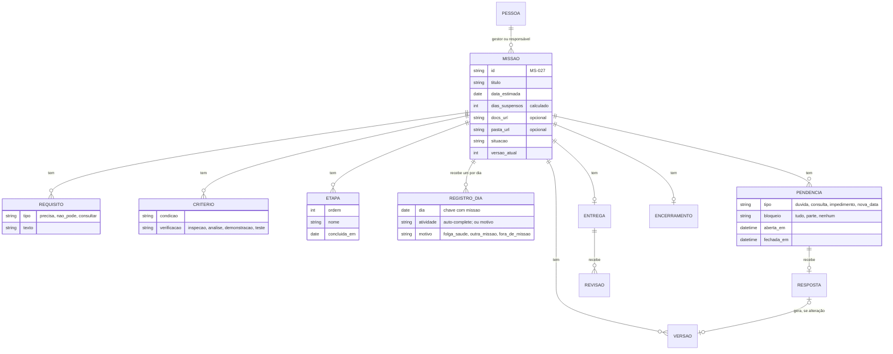
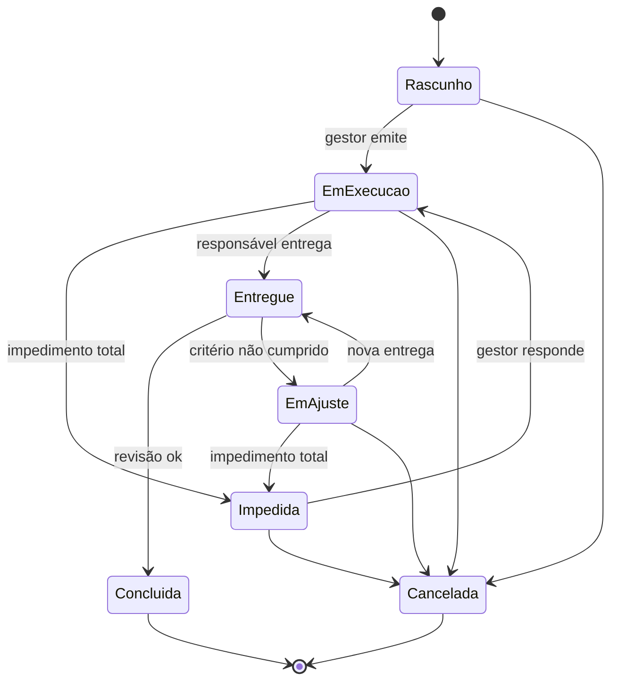

# Esquema do artefato agregador — Especificação do app de missões (PWA)

> **Status:** esqueleto para conferência. Cada seção diz **o que vai conter** e **de onde vem** no `protocolo_missoes.md` (v2.6). O conteúdo final é escrito na próxima conversa.

---

## 0. Como usar este artefato

- **Objetivo da próxima conversa:** sair com a especificação pronta para codificar o PWA.
- **Fonte de verdade:** `protocolo_missoes.md` v2.6. Em caso de conflito, o protocolo vence.
- **Regra para o agente:** usar práticas consagradas, não inventar mecanismos e não aumentar o registro diário do responsável.

## 1. Contexto e escopo

| Item | Conteúdo previsto |
|---|---|
| Equipe | 4 pessoas: 1 gestor, 3 responsáveis |
| Substitui | Kanban e GitHub Projects |
| Unidade | Missão = tarefa com ID, um responsável, uma data estimada única (não é projeto) |
| Escopo da v1 do app | Folha única por missão + lista de missões + notificações |
| Fora do escopo | Visão de equipe (WIP, prioridade, *heijunka*), complemento de pesquisa e teste |

## 2. Decisões vigentes

Tabela consolidada das decisões desta conversa: pergunta → decisão → motivo.
*Fonte:* nivelamento das 9 perguntas, v2.1 a v2.6, avaliações independentes.

## 3. Papéis e permissões

**Regra de acesso:** as missões são individuais.
- O **responsável** vê **somente as missões atribuídas a ele**. O app abre direto na folha da missão, sem lista. Ele não vê, não busca e não recebe notificação de missões de outras pessoas.
- **Só o gestor** vê a lista de missões da equipe e abre qualquer folha.
- Os links de Docs e de pasta seguem a mesma regra: são compartilhados só com o gestor e com o responsável da missão.
- **Sem atrito:** a tela do responsável não tem sinais, alertas, histórico nem análise. A análise fica só na tela do gestor (`analise_gestor.sql`).

Matriz **campo × papel** com quem **vê**, **edita** e **é notificado**.

| Bloco | Gestor | Responsável |
|---|---|---|
| 1. Cabeçalho: identificação, links Docs e pasta, data estimada, descrição, requisitos | edita (alteração após emitir) | vê |
| 2. Etapas (no início) | vê | edita e marca concluída |
| 3. Pendências | responde | abre e fecha |
| 4. Entrega / Revisão / Encerramento | revisa + 1 frase | entrega + 1 frase |
| 5. Registro do dia | não edita | grava (não vê histórico) |
| Análise: painel, sinais, linha do tempo | vê | **não vê** |

## 4. Modelo de dados

A seguir, a lista de campos por entidade, com o tipo, a obrigatoriedade e a origem no protocolo. As tabelas usadas pela análise já estão em `analise_gestor.sql` (PostgreSQL, testado com o exemplo MS-027).

## 5. Situações e transições

Tabela de regras: evento → condição → efeito → quem é notificado.

## 6. Regras de cálculo

Pseudofórmulas a detalhar:

| Regra | Esboço |
|---|---|
| Data estimada exibida | `data_estimada + dias suspensos` |
| Dias suspensos | dias úteis entre a abertura de um impedimento total e a resposta |
| Atividade em dias seguidos | sequência de registros com a mesma atividade (*gaps-and-islands*, `v_sequencias`) |
| Auto-complete | atividades já usadas na missão, mais recentes primeiro (`sugerir_atividades`) |
| Painel do gestor | `v_painel_gestor` |
| Versão "não vista" | alteração com `visto_em` nulo para o responsável |
| Dia útil | **a definir:** calendário de feriados |

## 7. Sinais

Só na tela do gestor. Implementados em `v_sinais`.

| Sinal | Quando aparece | Notifica? | Apaga quando |
|---|---|---|---|
| Dias sem registro | 2 dias úteis sem registro, fora de impedimento total | não (marca na lista) | registro feito |
| Data estimada passou | data passou sem entrega nem pedido de nova data | não (marca na lista) | entrega ou nova data |
| Pendência sem resposta | impedimento: 1 dia útil; demais: 2 | sim | resposta |
| Espera pela revisão | entregue há mais de 2 dias úteis | sim | revisão |
| Impedimento respondido e aberto | 3 dias úteis | sim | responsável fecha |

## 8. Telas

| Tela | Quem | Conteúdo previsto |
|---|---|---|
| Lista de missões | **só o gestor** | ID, título, responsável, situação, marca de sinal, data estimada |
| Folha da missão | responsável (só a dele) | Abre direto na missão atribuída; blocos 1 a 5, na ordem do protocolo; sem sinais nem histórico; registro do dia com data + atividade (auto-complete). Esboço: `tela_missao_funcionario.svg` |
| Folha espelhada (celular) | gestor | Mesma folha, só leitura, com o painel da missão e a linha do tempo dos registros; botões *responder*, *alterar* e *revisar* |
| Nova missão | gestor | Bloco 1, com os links de Docs e pasta e acesso para os encerramentos de missões parecidas |
| Pendência | gestor e o responsável da missão | Tipo, texto, resposta ou alteração, fechar |
| Notificações | cada um só as suas | Responsável: resposta recebida, alteração feita. Gestor: pendência aberta, sinais que o cobram, aviso do primeiro plano, entrega feita |

Esboço do layout de cada tela: wireframe em texto ou HTML estático.

## 9. Notificações

Matriz evento → destinatário → canal (push PWA) → texto curto.
Eventos: missão emitida, primeiro plano salvo, pendência aberta, resposta recebida, alteração feita, sinal na análise do gestor, entrega feita, revisão feita.

## 10. Fluxo de uso

Diagrama Mermaid do protocolo v2.6 (seção *Fluxo de uso do app*), copiado sem alteração.

## 11. Exemplo de ponta a ponta

A missão MS-027 como dados: o JSON da folha em cada momento-chave (emitida, impedida, entregue, concluída).

## 12. Fora da versão básica (backlog)

A tabela do protocolo, ordenada por valor para as próximas versões.

## 13. Questões em aberto para a próxima conversa

- Stack do PWA e armazenamento (offline primeiro? sincronização?).
- Autenticação (conta Google, aproveitando o Docs e a pasta?).
- Calendário de dias úteis e feriados (tabela `feriado`).
- Banco: PostgreSQL/Supabase, como em `analise_gestor.sql`, com regras de acesso por linha (o responsável só lê e grava a própria missão)?
- Docs e pasta: só os links (v1) ou criação automática via API (depois)?
- Responsável com duas missões ao mesmo tempo: seletor só das dele, ou uma missão por vez?
- Quem pode criar missão: só o gestor?
- Exportar o histórico de missões concluídas (memória técnica).
