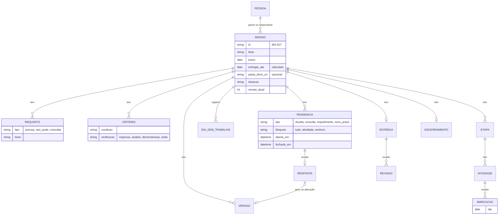
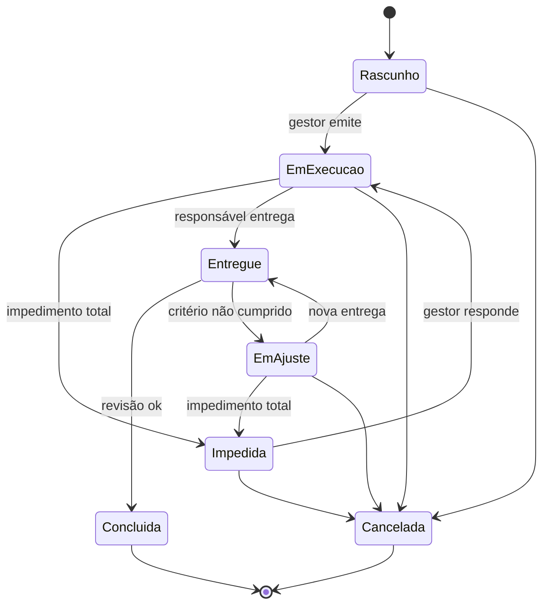

# Esquema do artefato agregador — Especificação do app de missões (PWA)

> **Status:** esqueleto para conferência. Cada seção diz **o que vai conter** e **de onde vem** no `protocolo_missoes.md` (v2.4). O conteúdo final é escrito na próxima conversa.

---

## 0. Como usar este artefato

- **Objetivo da próxima conversa:** sair com a especificação pronta para codificar o PWA.
- **Fonte de verdade:** `protocolo_missoes.md` v2.4. Em caso de conflito, o protocolo vence.
- **Regra para o agente:** usar práticas consagradas, não inventar mecanismos e não aumentar o registro diário do responsável.

## 1. Contexto e escopo

| Item | Conteúdo previsto |
|---|---|
| Equipe | 4 pessoas: 1 gestor, 3 responsáveis |
| Substitui | Kanban e GitHub Projects |
| Unidade | Missão = tarefa com ID, um responsável, um prazo único (não é projeto) |
| Escopo da v1 do app | Folha única por missão + lista de missões + notificações |
| Fora do escopo | Visão de equipe (WIP, prioridade, *heijunka*), complemento de pesquisa e teste |

## 2. Decisões vigentes

Tabela consolidada das decisões desta conversa: pergunta → decisão → motivo.
*Fonte:* nivelamento das 9 perguntas, v2.1 a v2.4, avaliações independentes.

## 3. Papéis e permissões

**Regra de acesso:** as missões são individuais.
- O **responsável** vê **somente as missões atribuídas a ele**. O app abre direto na folha da missão, sem lista. Ele não vê, não busca e não recebe notificação de missões de outras pessoas.
- **Só o gestor** vê a lista de missões da equipe e abre qualquer folha.
- A pasta do Drive segue a mesma regra: ela é compartilhada só com o gestor e com o responsável da missão.

Matriz **campo × papel** com quem **vê**, **edita** e **é notificado**.

| Bloco | Gestor | Responsável |
|---|---|---|
| 1. Cabeçalho (inclui a pasta do Drive) | edita | vê |
| 2. Missão | edita (alteração após emitir) | vê |
| 3. Requisitos da tarefa | edita (alteração após emitir) | vê |
| 4. Etapas e atividades | vê | edita |
| 5. Calendário | vê | edita |
| 6. Pendências | responde | abre e fecha |
| 7. Entrega / Revisão / Encerramento | revisa + 1 frase | entrega + 1 frase |

## 4. Modelo de dados

A seguir, a lista de campos por entidade, com o tipo, a obrigatoriedade e a origem no protocolo.

## 5. Situações e transições

Tabela de regras: evento → condição → efeito → quem é notificado.

## 6. Regras de cálculo

Pseudofórmulas a detalhar:

| Regra | Esboço |
|---|---|
| Entregar até | `prazo − 2 dias úteis + dias suspensos` |
| Dias suspensos | dias úteis entre a abertura de um impedimento total e a resposta |
| Painel | decorridos / disponíveis; atividades concluídas / total; dias sem trabalho por motivo |
| Etapa concluída | todas as atividades concluídas |
| Versão "não vista" | alteração com `visto_em` nulo para o responsável |
| Dia útil | **a definir:** calendário de feriados |

## 7. Sinais

Para cada sinal: gatilho → cor → destinatário → o que apaga.

| Sinal | Amarelo | Vermelho | Apaga quando |
|---|---|---|---|
| Dia vazio | … | … | … |
| Atividade que se arrasta | … | … | … |
| Sem conclusão | … | — | … |
| Prazo | … | … | … |
| Pendência sem resposta | … | … | … |
| Espera pelo gestor | — | … | … |

## 8. Telas

| Tela | Quem | Conteúdo previsto |
|---|---|---|
| Lista de missões | **só o gestor** | ID, título, responsável, situação, sinal mais forte, "entregar até" |
| Folha da missão | responsável (só a dele) | Abre direto na missão atribuída; blocos 1 a 7, na ordem do protocolo; marcação do dia em um toque. Esboço: `tela_missao_funcionario.svg` |
| Folha espelhada (celular) | gestor | Mesma folha, só leitura, com painel no topo; botões *responder*, *alterar* e *revisar* |
| Nova missão | gestor | Blocos 1 a 3, com campo para a pasta do Drive e link para os encerramentos de missões parecidas |
| Pendência | gestor e o responsável da missão | Tipo, texto, resposta ou alteração, fechar |
| Notificações | cada um só as suas | Amarelos (responsável), vermelhos (gestor), aviso do primeiro plano |

Esboço do layout de cada tela: wireframe em texto ou HTML estático.

## 9. Notificações

Matriz evento → destinatário → canal (push PWA) → texto curto.
Eventos: missão emitida, primeiro plano salvo, pendência aberta, resposta recebida, alteração feita, sinal amarelo, sinal vermelho, entrega feita, revisão feita.

## 10. Fluxo de uso

Diagrama Mermaid do protocolo v2.4 (seção *Fluxo de uso do app*), copiado sem alteração.

## 11. Exemplo de ponta a ponta

A missão MS-027 como dados: o JSON da folha em cada momento-chave (emitida, impedida, entregue, concluída).

## 12. Fora da versão básica (backlog)

A tabela do protocolo, ordenada por valor para as próximas versões.

## 13. Questões em aberto para a próxima conversa

- Stack do PWA e armazenamento (offline primeiro? sincronização?).
- Autenticação (conta Google, aproveitando a pasta do Drive?).
- Calendário de dias úteis e feriados.
- Pasta do Drive: só o link (v1) ou criação automática via API (depois)?
- Quem pode criar missão: só o gestor?
- Exportar o histórico de missões concluídas (memória técnica).
