# Fundamentos e Doutrina de Engenharia de Missões
**Do Contrato de Fronteira à Autonomia Responsável: O Espaço Semântico do Protocolo de Missões**

> **Propósito deste documento (Para Humanos e Modelos de IA):**
> Este texto é um documento de orientação técnica e argumentativa. Seu papel é estabelecer o **espaço semântico, conceitual e arquitetural** que governa o **Protocolo e Aplicativo de Missões**.
> - **Para o leitor humano (gestor ou engenheiro/executor):** explica *por que* ferramentas comuns de tarefas falham em trabalhos técnicos e *como* as organizações de engenharia mais avançadas do mundo resolvem a tensão entre alinhamento e autonomia.
> - **Para modelos de Inteligência Artificial (como o avaliador JEV e agentes de desenvolvimento):** funciona como uma âncora de contexto (*semantic priming*), ativando os referenciais corretos de **Engenharia de Requisitos (IEEE 29148 / Design by Contract)**, **Arquitetura Operacional (DoDAF OV-1/OV-5/OV-6a)**, **Sistemas de Missão Crítica (NASA/JPL e SpaceX)**, **Doutrina de Comando de Missão (Mission Command / C2)** e **Sistema de Desenvolvimento da Toyota (TPS / SBCE)**.

---

## 1. O Problema Central: A Falha Silenciosa na Fronteira da Tarefa

Em equipes técnicas, científicas, jurídicas ou de engenharia, raramente um projeto fracassa porque as pessoas "esqueceram que tinham uma tarefa". O fracasso ocorre em uma zona muito mais sutil: **a fronteira mal especificada entre a intenção de quem pede e o julgamento de quem executa**.

Quando uma tarefa não é tratada como um artefato de engenharia de requisitos, a equipe cai inevitavelmente em uma de duas patologias opostas:

1. **A Subespecificação por Abandono ("Entrega Cega"):** O gestor passa um título vago e um prazo (*"Testar o aditivo X até sexta"*). O executor trabalha duas semanas no escuro, tomando microdecisões invisíveis sobre limites, amostras e premissas. No dia da entrega, o gestor descobre que o resultado não serve para a decisão que precisava tomar. O retrabalho consome o dobro do tempo original.
2. **O Microgerenciamento por Insegurança ("Vigilância Letal"):** Para evitar a surpresa no fim, o gestor tenta prescrever o *como* passo a passo e exige relatórios diários de status. O profissional qualificado perde a autonomia cognitiva, para de observar a realidade do problema (*Genchi Genbutsu*) e passa a trabalhar apenas para "deixar o painel verde".

Ambas as patologias têm a mesma causa-raiz: **confundir o rastreamento de pacotes de trabalho com a especificação de um contrato de missão.**

---

## 2. Por Que as Ferramentas Convencionais (Trello, Jira, Asana) São Insuficientes

Os softwares comerciais de gestão de tarefas nasceram para gerenciar **filas de despacho** — cartões que se movem de *To Do* para *Doing* e *Done*. Embora úteis para fluxos repetitivos de tíquetes, eles apresentam quatro falhas estruturais quando aplicados a missões técnicas:

1. **Cegueira de Requisitos (O Cartão Aceita Qualquer Coisa):** Um cartão no Trello ou uma *issue* no Jira é uma caixa de texto em branco. Ele não obriga o emissor a separar a **Intenção** (*para que serve o resultado*) das **Restrições Invioláveis** (*o que não pode acontecer*).
2. **Ausência de Verificação de Entendimento (*No Backbrief*):** O cartão é empurrado para o executor sem exigir que este devolva seu plano de ataque antes de consumir recursos. Desalinhamentos graves só aparecem quando o prazo já estourou.
3. **Mistura Tóxica entre Espaço de Execução e Espaço de Cobrança:** O mesmo painel que o diretor usa para cobrar atrasos é a tela onde o técnico trabalha. Isso gera ansiedade defensiva: ninguém registra um impedimento real ou uma "margem de dúvida" em um mural público de cobrança.
4. **Amnésia Organizacional (*Open-Loop*):** Quando o cartão é arrastado para *Done*, o conhecimento sobre *por que* a especificação inicial estava incompleta ou *onde* o processo travou desaparece no arquivo morto. A próxima missão repete exatamente o mesmo erro de especificação.

Para superar essas limitações, não basta criar um "Trello mais simples". É necessário subir o nível de abstração e buscar as estratégias onde o erro de especificação custa caro demais: **engenharia aeroespacial, defesa e pesquisa avançada automotiva.**

---

## 3. A Linhagem Teórica: Como Sistemas Superiores Resolvem o Problema

O **Protocolo de Missões** não copia os softwares pesados dessas instituições, mas destila seus **mecanismos lógicos fundamentais** em uma única folha enxuta.

### 3.1. DoDAF (Department of Defense Architecture Framework) e Engenharia de Requisitos
Na Engenharia de Sistemas formal e no **DoDAF v2.0**, uma operação nunca é descrita apenas como uma lista de atividades. Ela exige a articulação de três visões operacionais complementares:
- **`OV-1` (*High-Level Operational Concept*) → O Propósito / Intenção:** Qual é o efeito desejado no sistema maior após a conclusão desta missão?
- **`OV-5b` (*Operational Activity Model*) → A Decomposição de Atividades e Entregáveis:** O que entra, o que é transformado e qual evidência verificável sai na outra ponta.
- **`OV-6a` (*Operational Rules Model*) → O Modelo de Regras de Restrição:** Sob quais regras de negócio e limites de segurança a atividade deve operar?

Combinado ao conceito de **Design by Contract** (Bertrand Meyer) e à norma **IEEE 29148 (Requirements Engineering)**, isso significa que toda missão bem formada é uma tríade lógica:
$$\text{Missão} = \langle \text{Pré-condições e Intenção}, \text{Invariantes de Fronteira}, \text{Pós-condições Verificáveis} \rangle$$

No nosso protocolo, essa tríade do DoDAF/IEEE materializa-se sem jargão burocrático nos campos de **Entrega e Propósito (`OV-1`/`OV-5b`)** e na tríade de critérios: **Precisa acontecer** (pós-condição obrigatória), **Não pode acontecer** (invariante de segurança / *hard constraint*) e **Consultar antes** (gatilho de escalonamento de decisão).

### 3.2. NASA / JPL: *Flight Rules*, *Playbook/PLEXIL* e *PRACA*
Em operações de espaço profundo no Jet Propulsion Laboratory (JPL/NASA), um comando leva até 20 minutos para chegar a Marte. O controle da missão não pode microgerenciar o rover, nem o rover pode violar limites térmicos ou energéticos. A engenharia aeroespacial resolve isso com três pilares:

1. ***Flight Rules* (Envelope de Autonomia Pré-Decidido):** Antes da missão, codificam-se as regras de voo: dentro do envelope verde, quem está na ponta decide sozinho sem pedir permissão; se um parâmetro tocar a linha vermelha (*Não pode acontecer*), a operação entra em parada segura (*Safe Hold*) e aciona a base (*Impedimento*).
2. **Separação entre Camada Deliberativa (*Playbook*) e Executiva (*PLEXIL*) com Margem:** Nenhum plano de missão consome 100% da janela temporal disponível; exige-se uma margem explícita para verificação e contingência antes da janela de entrega.
3. ***PRACA* (*Problem Reporting and Corrective Action*):** Toda anomalia ou ressalva encontrada em teste gera um fechamento em malha fechada (*closed-loop*) que obrigatoriamente atualiza a especificação da missão seguinte.

### 3.3. SpaceX: *Responsible Engineer (RE)* e Propagação de Impacto (*WarpDrive*)
A SpaceX substituiu a burocracia aeroespacial tradicional por dois princípios operados em seu sistema interno (*WarpDrive*):

1. **Propriedade e Questionamento do Requisito (*"Make your requirements less dumb"*):** O requisito não é uma tábua sagrada imutável. Quando o executor (*Responsible Engineer*) descobre na bancada que uma restrição da missão é fisicamente inviável ou desproporcionalmente cara (ex.: a capacidade real da estufa comporta metade das amostras previstas), seu dever profissional é abrir um **Impedimento** imediato para renegociar a versão do contrato (`Alteração v2`), mantendo o rastro histórico do que mudou e por quê.
2. **Grafo de Dependências e Propagação de Ressalvas:** Missões reais não vivem isoladas. Quando uma missão de ensaio (`MS-027`) encerra *Com ressalvas* (ex.: *"funciona apenas até a dosagem 4"*), as missões subsequentes que dependem dela precisam ser imediatamente sinalizadas no sistema de gestão.

### 3.4. US Army *Mission Command* (ADP 6-0) e Filtragem por Escalão em C2 Digital
A doutrina militar moderna de *Mission Command* e os estudos de Fatores Humanos do IEEE sobre sistemas digitais de Comando e Controle (C2) estabeleceram três regras de ouro para ambientes de alta incerteza:

1. **Intenção do Comandante (*Commander's Intent*) + Ordens de Missão (*Mission Orders*):** O líder define o *quê*, o *para quê* e os limites; o subordinado na linha de frente define o *como*.
2. **O *Backbrief* Estruturado:** Antes de iniciar a ação, quem vai executar devolve seu plano de etapas em poucas linhas. O objetivo não é burocratizar, mas detectar erros de interpretação antes que o tempo seja gasto.
3. **Filtragem Assimétrica por Escalão (*Echelon Filtering* contra a Vigilância Letal):** Pesquisas em C2 digital demonstram que exibir alarmes gerenciais na tela do operador destrói a iniciativa tática. Por isso, **a interface de quem executa a tarefa deve ser estruturalmente separada da interface de quem gerencia o portfólio.**

### 3.5. Sistema Toyota de Desenvolvimento (TPS / SBCE): *Jidoka*, *Heijunka*, *Genchi Genbutsu* e Curvas de Limite
Da engenharia de produto da Toyota (documentada por Ward, Liker e Sobek no MIT), o protocolo absorve a alma da sua rotina diária:
- ***Nemawashi* (Alinhamento Prévio):** Conversar rápido sobre o plano no Dia 1 evita semanas de atrito no fim.
- ***Jidoka* (Qualidade na Fonte e Direito de Parar a Linha):** O botão **Abrir pendência / Impedimento** é a *corda Andon* intelectual. Parar para pedir decisão diante de um bloqueio real não é fraqueza; é rigor técnico. Além disso, *Jidoka* exige que o próprio executor reserve **margem no prazo para revisar seu trabalho** antes de entregá-lo.
- ***Heijunka* (Nivelamento do Ritmo):** Fatiar a missão em etapas curtas e constantes evita a síndrome da corrida desesperada na véspera do prazo.
- **Engenharia Baseada em Conjuntos (*Set-Based Concurrent Engineering — SBCE*):** Em missões de pesquisa e teste, o sucesso não é "forçar um resultado positivo", mas mapear honestamente os **Desvios e limites** (até onde a solução atende e a partir de onde é inconclusiva ou falha).

---

## 4. A Síntese Arquitetural: Os Três Pilares do Nosso Sistema

Para transformar toda essa densidade teórica em uma ferramenta leve, rápida e humana, nossa arquitetura divide o sistema em **três papéis complementares e estritamente separados**:

```mermaid
flowchart LR
    subgraph GEST["1. Tela de Gestão de Tarefas (Gestor)"]
        G1["Intenção e Contrato de Fronteira (DoDAF OV-1/OV-6a / Flight Rules)"]
        G2["Fluxo de Missões e Dependências (Kanban / Obeya / WarpDrive)"]
        G3["Memória de Lições Aprendidas (PRACA / Hansei)"]
    end

    subgraph JEV["3. Avaliador Independente (IA / JEV)"]
        J1["Leitura Fria e Objetiva da Folha"]
        J2["Classificação Padronizada de Status"]
        J3["Orientação Técnica Sem Atrito Pessoal"]
    end

    subgraph RESP["2. Tela da Tarefa (Responsável)"]
        R1["Backbrief: Plano de Etapas pelo Executor"]
        R2["Guia Toyota: Margem de Revisão (Jidoka), Ritmo (Heijunka) e Teste Cedo"]
        R3["Corda Andon: Dúvida / Impedimento / Pedido de Alteração"]
    end

    GEST -->|"Emite Missão Clara"| RESP
    RESP -->|"Devolve Plano e Evidências"| GEST
    RESP -.->|"Dados Objetivos"| JEV
    GEST -.->|"Critérios e Prazos"| JEV
    JEV -->|"Status e Dica Neutra"| RESP
    JEV -->|"Diagnóstico de Fluxo"| GEST
```

### Pilar 1: A Tela da Tarefa (O Espaço Protegido do Responsável)
Na tela do responsável, existe **uma única missão em foco**. Não há gráficos de cobrança comparativa nem alarmes vermelhos gerenciais. O design atua como um *coach* silencioso da filosofia Toyota:
- Ao montar suas **Etapas**, o responsável é convidado a aplicar os **3 Conceitos Toyota de Planejamento Pessoal**:
  1. **Margem de Autorevisão (*Jidoka*):** Deixar tempo explícito antes do prazo final para revisar e validar a própria entrega.
  2. **Validação Antecipada (*Genchi Genbutsu / Front-loading*):** Colocar o teste mais difícil ou incerto logo na primeira etapa.
  3. **Ritmo Nivelado (*Heijunka*):** Quebrar o trabalho em passos curtos e verificáveis.

### Pilar 2: A Tela de Gestão de Tarefas (O Painel de Comando e Fluxo do Gestor)
A gestão não compete com o executor pelo controle do "como"; ela governa **a qualidade das especificações e o fluxo entre missões**:
- Enxerga o portfólio como uma sala *Obeya* / *Kanban de Missões* com **dependências explícitas** (sabendo imediatamente quais missões futuras são impactadas se uma missão atual atrasar ou entregar com ressalvas).
- Alimenta-se da **Memória de Lições (*PRACA / Hansei*)**: cada encerramento registra em 1 frase do responsável e 1 frase do gestor o que melhorar na próxima especificação, fechando o ciclo evolutivo da equipe.

### Pilar 3: O Avaliador Independente por IA (`JEV` — Julgador e Orientador Neutro)
Em qualquer organização humana, a avaliação direta de andamento entre chefe e subordinado pode gerar desgaste interpessoal ("trica"): o gestor sente que está sendo chato ao cobrar o plano ou a margem; o responsável sente que está sendo vigiado.
- O **JEV (Avaliador de IA)** resolve esse dilema atuando como um **instrumento de painel de aeronave**: neutro, técnico e impessoal.
- Ele lê os fatos objetivos da folha (os critérios de fronteira, as datas das etapas, a existência ou não de margem de revisão, o tempo de resposta a pendências) e **seleciona um status padronizado** dentro de uma taxonomia clara, acompanhado de uma **orientação prática de 1 linha**.
- Em vez de o gerente entrar em atrito com o responsável, ambos olham juntos para o diagnóstico objetivo do avaliador independente e agem sobre o processo.

---

## 5. Vocabulário Canônico do Espaço Semântico (Guia para Humanos e LLMs)

Sempre que um usuário, desenvolvedor ou modelo de IA interagir com este repositório, os termos abaixo possuem significado técnico estrito:

| Termo no Sistema | Significado na Engenharia de Missões | Equivalente na Literatura (Toyota / NASA / DoDAF / C2) |
|---|---|---|
| **Missão** | Contrato completo contendo propósito, entregável verificável, limites de autonomia e prazo. Nunca é apenas um "lembrete". | *Mission Order* (C2) / *Operational Specification* (DoDAF) |
| **Precisa acontecer** | Condição necessária e verificável de aceitação da entrega. | *Mandatory Post-conditions* (IEEE 29148) |
| **Não pode acontecer** | Invariante de fronteira ou restrição crítica que jamais deve ser violada para cumprir o prazo. | *Hard Flight Rules* (NASA) / *Safety Invariants* |
| **Consultar antes** | Limiar de autonomia: situações previstas onde o executor deve parar e alinhar antes de decidir sozinho. | *Escalation Triggers* / *Decision Gates* |
| **Etapas (Plano)** | Decomposição sequencial escrita **pelo responsável** (*backbrief*), incluindo margem para autorevisão. | *Backbrief* (Mission Command) + *Heijunka / Jidoka* (Toyota) |
| **Pendência (`impedimento`)** | Acionamento formal de parada porque uma condição externa bloqueou o avanço dentro das regras. | *Andon Cord* (Toyota) / *Safe-Hold Anomaly* (JPL) |
| **Alteração (`v2`, `v3`)** | Renegociação explícita e rastreável do contrato da missão quando a realidade invalida uma premissa inicial. | *Requirement Revision* (SpaceX WarpDrive) |
| **Desvios e limites** | Declaração honesta, no momento da entrega, de até onde a solução foi validada e quais ressalvas permanecem. | *Trade-off / Limit Curves* (Toyota SBCE) |
| **Frases de Encerramento** | Duas frases (1 do executor, 1 do gestor) que transformam a fricção da missão encerrada em melhoria para a próxima especificação. | *Hansei* (Toyota) / *Closed-Loop PRACA* (NASA) |
| **Avaliador JEV** | Agente de IA leve e independente que classifica o status operacional da folha e orienta as partes sem atrito pessoal. | *Independent Technical Telemetry / AI Judge* |
