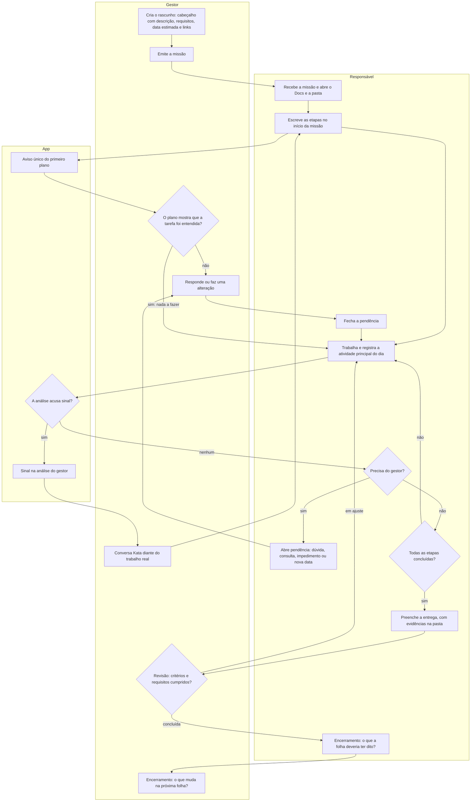

# Protocolo de missões

Versão 2.6 básica • 18/10/2026 • Equipe pequena • Folha única por missão (PWA)

## Princípio

Uma missão é uma tarefa com ID, um responsável e uma data estimada única. A folha da missão é o **acordo vigente**: o que não está nela não foi combinado.

**O gestor define o quê; o responsável define o como.** O gestor preenche o cabeçalho: a descrição da missão (necessidade, resultado esperado, tarefa, entrega, critérios de conclusão, insumos), os **requisitos da tarefa** (o que **precisa acontecer** e o que **não pode acontecer**) e a data estimada. Tudo o que o cabeçalho não fixa é decisão do responsável: as etapas, a ordem e o método. No Lean, respeitar as pessoas é deixá-las pensar e resolver os próprios problemas.

**A folha é preenchida durante a execução.** O responsável recebe a missão e escreve as etapas no início. Depois, a cada dia, registra a atividade principal em que trabalhou, abre pendências quando precisa e, no fim, preenche a entrega. O gestor vê a mesma folha, espelhada no celular, e só age quando precisa.

**Cada missão é individual.** A folha é vista só pelo gestor e pelo responsável. O responsável abre o app direto na sua missão e não acessa as missões dos outros; só o gestor vê a lista da equipe.

**Gestão sem atrito.** A folha informa; não cobra.
- O registro diário é **um campo de data e um de atividade, com auto-complete**. O responsável não precisa ver histórico: ele sabe em que está trabalhando, e há atividades que demoram mesmo. A tela dele **não tem sinais, alertas nem análise**.
- A **data estimada** é uma estimativa, não uma cobrança. Se mudar, o responsável informa a nova data.
- A **análise fica só na tela do gestor**, calculada a partir dos registros (`analise_gestor.sql`), e serve para ele saber onde remover obstáculos, não para cobrar quem executa.
- Quem encontra um problema para e o mostra (*jidoka*, andon).

**Linguagem.** A folha diz o porquê de cada pedido e evita termos de comando (apoio à autonomia, Teoria da Autodeterminação).

---

## Fluxo de uso do app

O gestor só entra em quatro pontos: ao emitir, ao ler o primeiro plano, ao responder uma pendência ou um sinal e na revisão. O resto do ciclo é do responsável.

---

## A folha, bloco a bloco

São cinco blocos, na ordem da tela do responsável. Cada bloco indica quem o preenche.

### 1. Cabeçalho (gestor)

**Identificação**
- **ID e título:** número sequencial; título com verbo + objeto. Ex.: *MS-027 — Calibrar sensor de umidade em solo argiloso*
- **Links** (opcionais), ao lado do título:
  - **Docs:** o documento do Google Docs da missão.
  - **Pasta:** a pasta do Google Drive onde ficam os insumos, o trabalho e as evidências.
  O app guarda só os links; o acesso é dado no próprio Google, para o gestor e o responsável.
- **Gestor e responsável:** uma pessoa cada. Ninguém revisa a própria entrega.
- **Data estimada:** quando se espera a entrega. É uma estimativa: se mudar, o responsável informa a nova data (bloco 3).
- **Versão:** avança a cada alteração do cabeçalho. Uma alteração aparece como **"não vista"** até o responsável abrir a folha.
- **Situação:** mostra quem precisa agir agora (ver *Situações*).

**Descrição**
- **Necessidade:** o que precisa ser resolvido, por que importa e que decisão depende disso.
- **Resultado esperado:** como fica a situação quando a missão termina bem. Se o plano não se encaixar na realidade, o responsável decide pela necessidade e pelo resultado esperado.
- **Tarefa:** o que fazer, em uma ou duas frases.
- **Entrega:** o quê, em que formato e onde. Se a missão tem pasta, o padrão é entregar nela.
- **Critérios de conclusão:** as condições que a **entrega** precisa cumprir, uma por linha, no formato **"[condição] — verificado por [inspeção / análise / demonstração / teste]"**.
  Ex.: *Erro médio ≤ 3 p.p. frente ao gravimétrico, em 5 níveis × 3 repetições — verificado por teste.*
  Se os critérios não cabem em três linhas, a missão está grande demais e deve ser dividida.
- **Insumos:** o que já está disponível e onde; o que estiver no Docs ou na pasta basta citar pelo nome. Antes de emitir uma missão parecida com outra já encerrada, o gestor relê o encerramento dela (bloco 4).

**Requisitos da tarefa**

São requisitos (MoSCoW) **globais à missão**: valem do primeiro ao último dia, para qualquer etapa ou atividade. Os critérios de conclusão dizem quando a entrega está pronta; os requisitos dizem o que vale no caminho até ela.
- **Precisa acontecer** (*Must*): o que tem que ser feito ou mantido durante toda a missão.
  Ex.: *Registrar todas as leituras, inclusive as descartadas, com o motivo.*
- **Não pode acontecer** (*Must not*): o que fica proibido, como um custo, um risco, um recurso ou um efeito colateral.
  Ex.: *Usar solo de outra classe textural.*
- **Consultar antes** (opcional): as decisões que pedem uma pendência de *consulta* (bloco 3) antes de agir.

**Se algo do "não pode acontecer" acontecer,** o responsável para o trabalho afetado e abre um impedimento no mesmo dia. Parar cedo é o comportamento esperado, e a pergunta é sempre o que no processo permitiu isso (*jidoka*).

Depois de emitida a missão, só uma **alteração** muda o cabeçalho (bloco 3).

### 2. Etapas (responsável, no início)

As etapas são o plano do responsável, escrito **no início da missão**, para alinhar a percepção do que a tarefa pede. São poucas, cada uma com um nome que diz o resultado. Ex.: *Amostras preparadas*, *Níveis 1 a 3 medidos*.
- O responsável marca a etapa como concluída quando ela termina.
- Pode editar as etapas se o entendimento mudar, sem aprovação. As etapas não têm data própria.
- Etapa não é atividade: a etapa é uma parte do resultado, definida uma vez; a atividade é o que se fez num dia (bloco 5).

**Aviso do primeiro plano.** Quando o responsável salva as etapas pela primeira vez, o gestor recebe um aviso único. Não é aprovação: se o gestor perceber que a tarefa foi entendida de outro jeito, faz uma alteração; se não, não faz nada. É o *backbrief* reduzido a uma leitura.

### 3. Pendências (responsável abre; gestor responde)

| Tipo | Quando usar | O que escrever |
|---|---|---|
| **Dúvida** | Algo na folha não está claro | A pergunta e o item da folha |
| **Consulta** | Uma decisão listada em "consultar antes" | "Pretendo [ação], porque [motivo]." |
| **Impedimento** (andon) | Algo impede o trabalho, um requisito não pode ser cumprido, ou algo do "não pode acontecer" aconteceu | O que impede; se bloqueia tudo ou só uma parte; o que já foi tentado |
| **Nova data** | A data estimada mudou | Motivo e nova data, assim que perceber |

**Abrir um impedimento é bem-vindo.** Mostrar o problema cedo é o que o andon pede, e não é motivo de cobrança.

**A resposta do gestor é de um de dois tipos:**
- **Resposta:** esclarece, e a folha não muda. Aparece na folha do responsável, junto da pendência.
- **Alteração:** muda o cabeçalho ou a data estimada. A versão avança, e a folha mostra o que mudou.

**Quem abre a pendência é quem a fecha,** depois de confirmar que a resposta resolve. Responder não fecha a pendência.

**Enquanto uma pendência espera:**
- Dúvida, consulta e nova data não param a missão: o trabalho segue em tudo o que não depende delas.
- O impedimento que bloqueia só uma parte não para o restante.
- O impedimento que bloqueia tudo leva a missão para "Impedida". A data estimada avança pelos dias úteis entre a abertura e a resposta do gestor, e a folha mostra o motivo. Ex.: *data estimada 29/10 (+2 por impedimento)*.

Uma missão inviável não é recusada: o responsável abre um impedimento dizendo por quê.

### 4. Entrega, revisão e encerramento

**Entrega (responsável):**
- **Resultado:** o que foi obtido, separando o dado da interpretação.
- **Evidência por critério de conclusão:** atendido / parcial / não atendido, e onde está a evidência (de preferência, no Docs ou na pasta).
- **Desvios e limites:** o que mudou em relação ao combinado, se algum requisito ficou em risco, e o que o resultado não permite concluir.

**Revisão (gestor),** em até 2 dias úteis, **somente pelo que está na folha:** os critérios de conclusão foram atendidos? O que precisava acontecer aconteceu, e o que não podia acontecer não aconteceu? O gestor abre a evidência, não só o resumo. Uma exigência nova vira outra missão, não um ajuste desta. São dois olhares separados:
1. **A missão foi concluída?** Critérios e requisitos foram cumpridos e as evidências estão lá?
2. **O que o resultado diz sobre o produto?** Atende, não atende ou é inconclusivo.

Uma missão pode estar concluída mesmo quando o produto falha. Achar a falha costuma ser o melhor resultado de um teste.

A revisão termina como **concluída** ou **em ajuste**. Neste caso, cada ajuste aponta o critério ou o requisito não cumprido.

**Encerramento:**
- **Responsável,** em uma frase: **O que a folha deveria ter dito desde o início?**
- **Gestor,** em uma frase: **O que muda na próxima folha?**

As duas frases melhoram as próximas missões. Uma dúvida aberta mostra onde a folha não foi clara, não onde o responsável falhou. As missões concluídas ficam consultáveis, inclusive as de resultado negativo.

### 5. Registro do dia (responsável)

É o último bloco e o único de uso diário. Tem dois campos e um botão:
- **Data:** hoje, por padrão. Pode ser trocada para registrar um dia anterior esquecido.
- **Atividade principal:** o que ocupou a maior parte do dia na missão (verbo + objeto). O campo tem **auto-complete** com as atividades já registradas nesta missão, para que a mesma atividade seja escrita do mesmo jeito.
- **Ou sem trabalho na missão**, com um toque no motivo: folga ou saúde; outra missão; demanda fora de missão.

Um registro por dia, sem descrição. A tela não mostra histórico, contagem nem alerta: o registro é informação para a análise do gestor, não cobrança.

---

## Situações

| Situação | Quem age | Sai para |
|---|---|---|
| Rascunho | Gestor | Em execução (ao emitir) |
| Em execução | Responsável | Impedida, Entregue |
| Impedida | Gestor | A situação anterior, quando o gestor responde |
| Entregue | Gestor | Concluída, Em ajuste |
| Em ajuste | Responsável | Entregue, Impedida |
| Concluída | — | — |
| Cancelada | — | — |

- Só o impedimento que bloqueia tudo muda a situação. As demais pendências não mudam.
- Quando o gestor responde a um impedimento, a missão volta a "Em execução" ou a "Em ajuste", e a pendência continua aberta até o responsável fechá-la.
- O gestor pode cancelar a missão em qualquer situação aberta, registrando o motivo.

---

## Análise do gestor

A análise sai só dos registros do dia, das etapas e das pendências, sem nenhum campo extra. **Não aparece para o responsável.** O SQL está em `analise_gestor.sql`.

**Painel do gestor** (uma linha por missão aberta): responsável, situação, data estimada (com os dias suspensos), etapas concluídas, último registro, atividade atual e **há quantos dias seguidos** ela é a atividade principal, dias em outra missão e fora de missão, e os sinais.

**Sinais:**

| Sinal | Quando aparece | Notifica o gestor? |
|---|---|---|
| Dias sem registro | 2 dias úteis seguidos sem registro (nem atividade, nem motivo), fora de impedimento total | Não: marca na lista |
| Data estimada passou | A data passou sem entrega nem pedido de nova data | Não: marca na lista |
| Pendência sem resposta | Impedimento sem resposta no mesmo dia; demais tipos após 1 dia útil | Sim |
| Espera pelo gestor | Entregue sem revisão após 2 dias úteis; impedimento respondido, mas aberto há 3 dias úteis | Sim |

A **atividade em dias seguidos** é uma coluna, não um sinal: há atividades que demoram mesmo. Metade dos sinais cobra o próprio gestor. O sinal só apaga quando a causa some: o registro é feito, a nova data é informada, a pendência é fechada ou a revisão é feita.

**Diante de um sinal,** o gestor primeiro abre a linha do tempo da missão (os registros, dia a dia): uma atividade longa pode ser só uma atividade longa. Se precisar conversar, pergunta antes de propor (coaching Kata), diante do trabalho real (a amostra, a planilha, o código), não só da tela:
1. Qual é o resultado esperado?
2. Onde estamos agora?
3. O que está impedindo, e qual obstáculo você ataca agora?
4. Qual é o próximo passo, e o que você espera que aconteça?
5. Quando podemos ver juntos o que você aprendeu com esse passo?

A solução continua com o responsável. O gestor remove o obstáculo que só ele pode remover.

**O sinal aponta para o processo, não para a pessoa.** Antes de tudo, pergunte: o que na missão, no insumo ou na carga permitiu isso? Se o registro virar vigilância, as pessoas passam a registrar o que agrada, e a análise perde o valor.

Os limiares (2 dias; 1 dia; 2 e 3 dias) são valores iniciais. Ajuste-os com o uso.

---

## Exemplo

**MS-027 — Calibrar sensor de umidade em solo argiloso** • Docs ↗ • Pasta ↗ • Emitida em 19/10 • Data estimada: 28/10 • v1

**Descrição**
- **Necessidade:** saber se o sensor v2 mede bem em solo argiloso para ir ao piloto com agricultores.
- **Resultado esperado:** a curva de calibração para solo argiloso, com erro conhecido.
- **Tarefa:** comparar as leituras do sensor com o método gravimétrico em amostras de solo argiloso.
- **Entrega:** planilha e curva de calibração na pasta.
- **Critérios de conclusão:** erro médio ≤ 3 p.p. frente ao gravimétrico, em 5 níveis × 3 repetições — verificado por teste.

**Requisitos da tarefa**
- **Precisa acontecer:** registrar todas as leituras, inclusive as descartadas, com o motivo.
- **Não pode acontecer:** usar solo de outra classe textural.
- **Consultar antes:** mudar o número de níveis ou de repetições.

**Como foi:**
- **19/10:** o responsável escreve as etapas *Amostras preparadas*, *Níveis 1 a 3 medidos*, *Níveis 4 e 5 medidos* e *Planilha consolidada*. O gestor recebe o aviso do primeiro plano, lê e não faz nada. No fim do dia, registra *preparar amostras n1*.
- **Durante a semana:** o responsável decide sozinho a ordem das coletas e repete uma amostra suspeita, porque nada disso está nos requisitos.
- **20 a 22/10:** o responsável registra *secar amostras n1* três dias seguidos, escolhendo a mesma atividade no auto-complete. No dia 22, percebe que a estufa só seca 3 amostras por ciclo: os 5 níveis não cabem até 28/10. Abre um **impedimento** que bloqueia só o nível 5 e sugere 4 níveis × 3 repetições.
- O gestor responde no mesmo dia com uma **alteração**: o critério de conclusão passa a 4 × 3, e a folha vai para a v2, que aparece como "não vista" até o responsável abrir a folha. Ele fecha o impedimento e troca a etapa *Níveis 4 e 5 medidos* por *Nível 4 medido*.
- **27/10, entrega:** erro médio de 2,4 p.p. — atendido. Todas as leituras registradas, inclusive 2 descartadas, com o motivo. Limite: o resultado não vale para umidade acima do nível 4.
- **28/10, revisão:** missão **concluída**. Produto: **atende** de 0 ao nível 4; **inconclusivo** acima.
- **Encerramento.** Responsável: "A folha deveria ter dito a capacidade da estufa." Gestor: "Nas próximas calibrações, a capacidade da estufa entra nos insumos."

Nenhum alerta foi disparado e ninguém foi cobrado. Quem trabalhava percebeu o problema e o mostrou; no painel, o gestor viu *secar amostras n1 — 3 dias seguidos* junto com o impedimento já aberto. A próxima missão de calibração já nasce com esse insumo.

---

## Fora da versão básica

| Item | Por que ficou fora | Quando reconsiderar |
|---|---|---|
| Acordo, *catchball* e frase de acordo | O cabeçalho é do gestor, e a folha é preenchida durante a execução, sem passo de aprovação. O aviso do primeiro plano cobre o essencial | Se mal-entendidos da tarefa aparecerem com frequência no encerramento |
| Declinar com motivo | Uma missão inviável vira impedimento | — |
| Etapas fixas e primeira peça | O como é do responsável | Se desvios de caminho forem descobertos só na entrega |
| Aviso de intenção com silêncio como concordância | Substituído pela pendência de consulta e pela tela espelhada | — |
| Bloco "Autonomia" em três níveis | A autonomia passa a ser tudo o que o cabeçalho não fixa; resta só "consultar antes" | — |
| Sinais, alertas, calendário, histórico e andamento na tela do responsável | Gestão sem atrito: ele só registra a atividade do dia; a análise é do gestor, e há atividades que demoram mesmo | — |
| Atividades como subitens das etapas, com marcação de concluída | Etapa é o plano do início; atividade é o registro do dia. Misturar as duas dobrava o cadastro | — |
| Mais de uma atividade por dia | O registro é da atividade principal; basta para a análise | Se a análise mostrar que a atividade principal esconde trabalho relevante |
| Prazo com revisão embutida e "entregar até" | Criavam cobrança entre responsável e gestor; substituídos pela data estimada | — |
| Requisitos *Should*, *Could* e *Won't* (MoSCoW completo) | A versão básica fica só com o que é obrigatório e o que é proibido | Se surgirem missões com escopo negociável |
| Requisitos-padrão herdados por todas as missões | Os requisitos são globais à missão, não à equipe | Na visão de equipe (trabalho padronizado) |
| Limite de duração da missão (ex.: 10 dias úteis) | O tamanho já é controlado pelas três linhas de critério | Se missões longas passarem a acumular desvios descobertos tarde |
| Etapas ou registros feitos pelo gestor | Conflita com "o como é do responsável" | — |
| Esforço previsto | Só a data estimada é combinada | Quando houver histórico para estimar |
| Apoio (contribuidor) | Uma missão, um responsável | Se surgirem missões com partes bem definidas para outra pessoa |
| Sugestão de mudança como tipo de pendência | A dúvida e o impedimento cobrem o caso | Se as dúvidas passarem a carregar propostas de mudança com frequência |
| Motivo marcado para um intervalo de dias ("outra missão até sexta") | Detalhe de interface; reduz o registro e pode entrar se for barato de implementar | Na primeira versão do app |
| Integração com a API do Google (criar o Docs e a pasta ao emitir, listar arquivos, anexar evidência pelo app) | A versão básica guarda só os links; o acesso fica no próprio Google | Quando colar os links passar a ser atrito real |
| Limite de 2 missões por pessoa, prioridade entre missões e nivelamento (*heijunka*) | São regras entre folhas, e o app é de folha única | Na visão de equipe (várias folhas) |
| Sinal de carga invisível entre folhas | Depende da visão entre folhas; dentro da folha, o painel do gestor já soma os dias sem trabalho | Junto com a visão de equipe |
| Biblioteca de insumos e requisitos aprendidos | Por enquanto, o gestor relê os encerramentos das missões parecidas | Na visão de equipe |
| Tabela de critérios em 4 colunas (condição, medida, critério, verificação) | Pesada para missões simples; a linha "condição — verificado por" mantém o núcleo verificável | Missões técnicas com vários requisitos |
| Complemento de pesquisa e teste (pergunta, hipótese, protocolo antes dos dados, limites) | É um tipo especial de missão | Primeira extensão recomendada (ver `proposta_solicitacao_pesquisa_testes.md`) |
| "Falhas encontradas" e "não verificado" na entrega | Cabem em "resultado" e em "parcial / não atendido" | Junto com o complemento de pesquisa e teste |
| "Concluída com ressalva" | A ressalva vira outra missão de qualquer forma | — |
| Revisão pós-ação completa ("o que deveria acontecer?", "o que aconteceu?", "por que houve diferença?") | A entrega já compara o combinado com o real em "desvios e limites"; o encerramento concentra o aprendizado para a folha | Se a equipe quiser revisão pós-ação completa |
| Contagem de dúvidas e impedimentos por missão | Métrica de melhoria entre missões | Na visão de equipe |

---

## Origem dos elementos

| Elemento | Prática de origem |
|---|---|
| Necessidade, resultado esperado | Intenção do comandante; comando por missão |
| Requisitos da tarefa: precisa / não pode acontecer | Priorização MoSCoW (DSDM), níveis *Must*; *constraints* e *restraints* do comando por missão (ADP 6-0) |
| O que o cabeçalho não fixa é do responsável | Respeito às pessoas e liderança Lean (Toyota); liberdade de ação do comando por missão |
| Aviso do primeiro plano | *Backbrief* (ADP 6-0), reduzido a uma leitura |
| Responsável único; data estimada; nova data informada cedo | Controle de tarefas dos estados-maiores (OPR, *suspense*) |
| Critérios de conclusão com forma de verificação | Verificação de requisitos (ISO/IEC/IEEE 29148): inspeção, análise, demonstração, teste |
| Resposta versus alteração; versões | Controle de mudanças de engenharia |
| Registro diário sem alerta para quem executa; análise para o gestor | Controle visual (*mieruka*; Liker, princípio 7); respeito às pessoas |
| Parar diante do "não pode acontecer" | *Jidoka* (Ohno; Liker, princípio 5) |
| Impedimento | Andon (Toyota) |
| Pendência com resposta no tempo e sinal de espera pelo gestor | Regra 2 do TPS: pedido direto com resposta no tempo combinado (Spear & Bowen, HBR, 1999); espera como desperdício (Ohno) |
| Perguntas diante de um sinal, diante do trabalho real | Coaching Kata (Rother, *Toyota Kata*); *genchi genbutsu* (Liker, princípio 12) |
| Encerramento do responsável e do gestor | Revisão pós-ação (AAR, TC 25-20); *hansei*; kaizen da instrução |
| Linguagem com porquê e sem tom de comando | Teoria da Autodeterminação (apoio à autonomia) |
| Situações e regras | DoDAF OV-6b (estados) e OV-6a (regras) |
